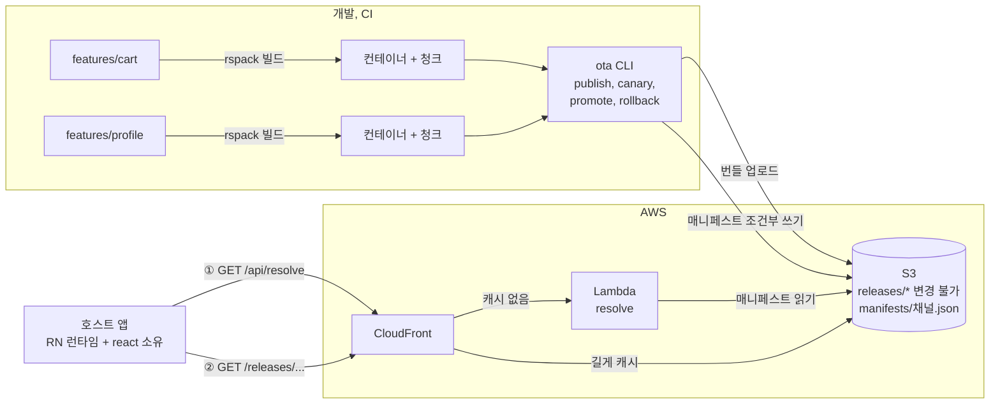
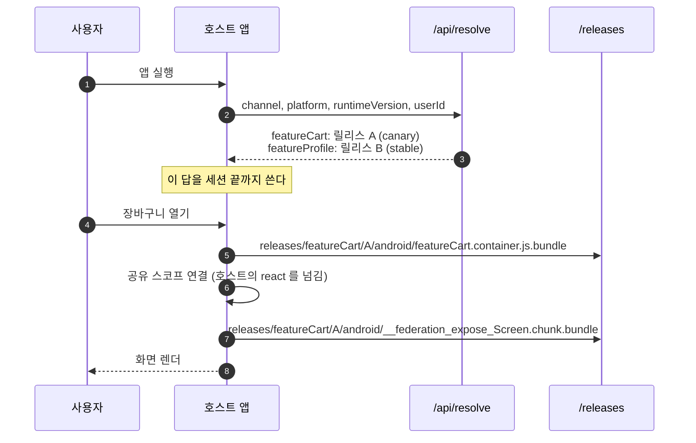
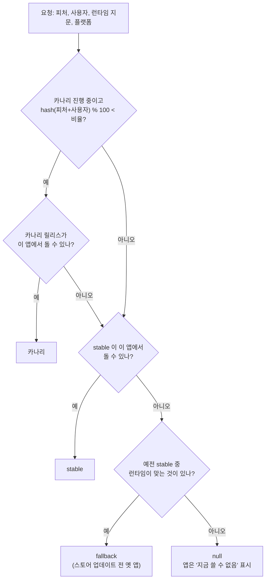
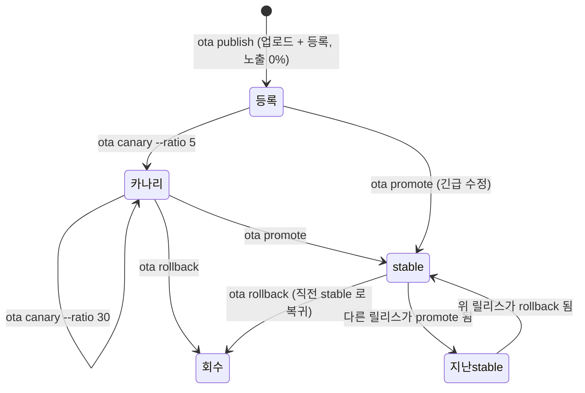
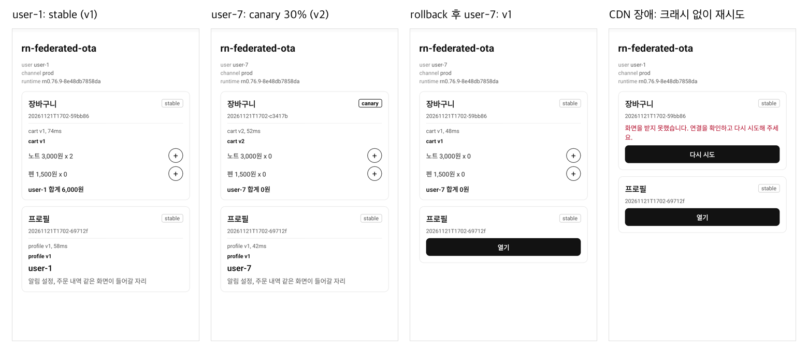

# rn-federated-ota

React Native 앱의 화면 일부를 **앱 스토어 심사 없이 따로 배포**하는 구조의 샘플입니다.
화면 단위 번들(Module Federation)을 S3와 CloudFront로 내려주고, 누구에게 어느 버전을 줄지(채널, 카나리, 롤백, 호환성)는 resolve API 한 곳에서 정합니다.

세 가지를 참고해 조합했습니다.

| 참고한 것 | 가져온 생각 | 이 저장소에서 |
|---|---|---|
| [Re.Pack](https://re-pack.dev) 의 Module Federation | 호스트가 react, react-native 를 들고 있고 화면 번들은 빌려 쓴다 | `apps/host`, `features/*` |
| Toss 의 [Granite](https://github.com/toss/granite) | 셸과 서비스 번들 사이의 버전 계약, 번들 배포 인프라를 프레임워크 일부로 본다 | 런타임 지문(`runtimeVersion`), `infra/` |
| [hot-updater](https://github.com/gronxb/hot-updater) | 자체 호스팅 OTA. 채널, 롤백, 앱과 호환되는 번들만 고르는 서버 측 판단 | `packages/ota-*` |

hot-updater 는 앱 번들 전체를 바꾸고, 이 저장소는 피처(화면) 번들 하나씩 따로 바꿉니다. 그래서 "어느 앱에 맞는 번들인가"를 앱 버전이 아니라 공유 의존성 지문으로 판단합니다. 아래 [설계 판단](#설계-판단)에 이유를 적었습니다.

## 구조



| 경로 | 무엇 | 캐시 |
|---|---|---|
| `GET /api/resolve` | 이 사용자, 이 앱에게 줄 피처별 릴리스 | 없음 (사용자마다 답이 다름) |
| `GET /releases/<피처>/<릴리스>/<플랫폼>/<파일>` | 번들 파일 | 1년, immutable (주소에 내용 해시) |
| 그 외 | 404 | |

매니페스트(`manifests/<채널>.json`)는 CDN 으로 공개하지 않습니다. 회수한 릴리스와 카나리 비율이 들어 있어서 밖에 보일 이유가 없습니다.

## 앱이 켜질 때



resolve 는 세션당 한 번입니다. 보는 도중에 배포가 바뀌어도 이번 세션은 처음 받은 릴리스를 씁니다. Module Federation 런타임은 한 번 로드한 컨테이너를 교체할 수 없고, 중간에 바꾸면 이미 연 화면과 새로 열 화면의 버전이 섞입니다. 새 배포는 다음 콜드 스타트에 반영됩니다.

앱 쪽에서 이 흐름을 쥐는 곳은 [`apps/host/src/ota/scriptManager.ts`](apps/host/src/ota/scriptManager.ts) 하나입니다. Re.Pack 이 "이 스크립트는 어디 있나"를 물으면 resolve 결과로 주소를 만들어 답합니다.

## 누구에게 어떤 번들을 주나

[`packages/ota-core/src/resolve.ts`](packages/ota-core/src/resolve.ts) 의 순서가 곧 정책입니다.



"이 앱에서 돌 수 있다"는 세 조건을 모두 만족한다는 뜻입니다. 회수(rollback)되지 않았고, 런타임 지문이 같고, 요청한 플랫폼 산출물이 있어야 합니다.

런타임 지문이 다른 번들은 어떤 경우에도 내려주지 않습니다. 피처 번들은 react, react-native 를 호스트에게서 빌려 쓰므로 버전이 어긋나면 화면이 깨지는 정도가 아니라 앱이 죽을 수 있습니다.

## 릴리스의 일생



번들 파일은 한 번 올리면 바뀌지 않습니다. 배포, 카나리, 롤백은 전부 매니페스트의 포인터만 바꾸므로 몇 초 안에 끝나고, 롤백할 때 다시 빌드하거나 다시 올릴 것이 없습니다.

```bash
npm run ota -- publish featureCart --app features/cart --android features/cart/build/generated/android
npm run ota -- canary featureCart 20261122T0310-3f2a9c --ratio 10
npm run ota -- promote featureCart          # 진행 중인 카나리를 stable 로
npm run ota -- rollback featureCart         # 카나리 회수, 없으면 직전 stable 로
npm run ota -- status
```

CI 에서는 [`deploy-feature`](.github/workflows/deploy-feature.yml) 가 `features/` 변경을 감지해 빌드, 업로드, 카나리 5% 까지 하고, stable 승격과 롤백은 사람이 [`release-control`](.github/workflows/release-control.yml) 로 누릅니다.

## 설계 판단

검토한 다른 방법과 고르지 않은 이유를 같이 적습니다.

**결정은 서버(resolve API)에서 한다.**
앱이 매니페스트를 직접 받아 스스로 고르는 방식(CodePush 계열)도 가능하고, 서버가 없어 더 단순합니다. 고르지 않은 이유는 두 가지입니다. 매니페스트 전체(회수한 릴리스, 다른 피처의 카나리 비율)가 모든 기기에 내려가고, 선택 규칙을 고칠 때마다 앱을 새로 내야 합니다. 서버에 두면 규칙 변경이 Lambda 배포로 끝납니다. 대가는 앱 시작마다 API 호출 한 번이고, 실패하면 원격 피처 없이 뜹니다.

**호환성 기준은 앱 버전이 아니라 런타임 지문이다.**
피처가 실제로 의존하는 것은 앱 버전이 아니라 호스트가 공유 스코프에 올린 react, react-native 의 설치 버전입니다. 앱 버전으로 판단하면 네이티브 변경 없는 앱 업데이트마다 피처를 다시 내야 하고, 반대로 앱 버전은 같은데 의존성만 바뀐 경우를 놓칩니다. 그래서 `package.json` 의 `ota.shared` 목록과 실제 설치 버전을 해시합니다([`runtime.ts`](packages/ota-core/src/runtime.ts)). 호스트는 빌드 때 이 값을 번들에 박고, 피처는 배포 때 매니페스트에 적습니다. Granite 가 셸과 서비스 번들 사이에 두는 버전 계약을 문자열 하나로 줄인 셈입니다.

**매니페스트 동시 수정은 S3 조건부 쓰기로 막는다.**
CI 에서 두 피처가 동시에 배포되면 둘 다 같은 매니페스트를 읽고 각자 고쳐 씁니다. 조건 없이 쓰면 늦게 쓴 쪽이 먼저 쓴 쪽의 변경을 지웁니다. DynamoDB 로 잠금을 따로 두는 방법도 있지만, 매니페스트가 채널당 파일 하나라 S3 의 `If-Match` 만으로 충분하고 관리할 리소스가 하나 줄어듭니다. 충돌하면 최신 매니페스트를 다시 읽고 같은 "의도"(예: 카나리 30% 시작)를 다시 적용합니다. 그래서 매니페스트 연산은 전부 순수 함수로 뒀습니다([`manifest.ts`](packages/ota-core/src/manifest.ts)).

**올리기와 내보내기를 나눈다.**
`publish` 는 업로드하고 등록만 합니다. 노출은 `canary`, `promote` 가 따로 합니다. 업로드가 중간에 실패해도 매니페스트에는 흔적이 없으니 반쯤 올라간 릴리스가 사용자에게 갈 일이 없고, 자동화(CI)와 판단(사람)의 경계가 명령 단위로 갈립니다.

**롤백은 포인터를 되돌리고 회수 표시를 남긴다.**
포인터만 되돌리면, 런타임이 안 맞는 옛 앱을 위한 fallback 경로가 문제의 릴리스를 다시 고를 수 있습니다. 회수(`revokedAt`)된 릴리스는 어떤 경로로도 다시 나가지 않습니다.

**카나리 버킷은 hash(피처 + 사용자) 다.**
`Math.random()` 이면 같은 사용자가 앱을 켤 때마다 버전이 바뀌고, 지표에서 두 집단이 섞입니다. 피처 이름을 섞는 이유는, 사용자 id 만 쓰면 버킷이 낮은 사용자가 모든 피처의 카나리를 한꺼번에 받아 문제가 났을 때 원인을 가르기 어렵기 때문입니다.

## 검증

| 무엇 | 어떻게 | 결과 |
|---|---|---|
| 매니페스트 연산, resolve 정책, 버킷 분포 | `npm test` (node:test) | 32건 통과 |
| CDK 인프라 (공개 차단, 캐시 정책, IAM 최소 권한) | `npm test -w infra` | 5건 통과 |
| 배포 파이프라인 전체 | `npm run e2e` (실제 피처 빌드 → 로컬 서버 → 카나리 → 롤백) | 76건 통과 |
| 앱에서 실제로 받아 렌더 | Android 에뮬레이터(API 34) 릴리스 빌드 + 로컬 서버 | 4개 시나리오 확인 |



카나리 30% 상태에서 버킷이 86인 user-1 은 v1, 버킷이 28인 user-7 은 v2 를 받았습니다. `ota rollback` 한 줄 뒤 앱을 다시 켜자 user-7 도 v1 으로 돌아왔고, APK 는 다시 설치하지 않았습니다.

서버 로그로 확인한 다운로드는 피처당 두 건(컨테이너, 화면 청크)뿐이었습니다. 빌드할 때 같이 생기는 react-native 폴백 청크는 한 번도 요청되지 않았습니다. 원격 화면 안의 `useState` 가 동작한다는 것이 호스트와 React 인스턴스를 공유한다는 증거입니다.

장애 시나리오는 두 가지를 봤습니다. 앱 시작 때 서버가 꺼져 있으면 resolve 실패 화면과 재시도 버튼이 뜹니다. resolve 뒤에 CDN 이 끊기면 그 피처만 오류가 나고 다른 피처는 정상이며, 서버가 돌아온 뒤 재시도하면 같은 릴리스를 받아 뜹니다. 어느 쪽도 앱이 죽지 않았습니다.

## 직접 돌려 보기

Node 22.18 이상이 필요합니다(TypeScript 를 빌드 없이 실행).

```bash
npm ci
(cd apps/host && npm ci) && (cd features/cart && npm ci) && (cd features/profile && npm ci)

npm test            # 단위 테스트
npm run e2e         # 로컬 end-to-end
```

Android 에뮬레이터에서 보려면:

```bash
# 1. 로컬 서버 (CloudFront + Lambda 역할)
npm run server

# 2. 피처 빌드, 배포
(cd features/cart && npm run bundle:android)
npm run ota -- publish featureCart --app features/cart --android features/cart/build/generated/android
npm run ota -- promote featureCart <위에서 나온 releaseId>

# 3. 호스트 앱 빌드, 설치, 사용자를 바꿔 가며 실행
(cd apps/host && npm run build:android)
adb install -r apps/host/android/app/build/outputs/apk/release/app-release.apk
adb shell am start -n com.otahost/.MainActivity --es userId user-7
```

AWS 에 올리려면:

```bash
cd infra && npx cdk deploy -c githubRepo=<owner>/<repo>
# 출력의 BaseUrl 을 OTA_BASE_URL 로 넣어 호스트를 빌드하고,
# BucketName, GithubDeployRoleArn 을 저장소 변수(OTA_BUCKET, AWS_ROLE_ARN, AWS_REGION)로 둔다.
```

## 디렉터리

```
apps/host/            호스트 앱 (RN 0.76, Re.Pack 5). 런타임과 공유 의존성 소유
  src/ota/            resolve 호출, 스크립트 주소 결정, 로드 실패 처리
features/cart/        원격 피처. react, react-native 는 빌려 씀
features/profile/     원격 피처 (다른 팀이 따로 배포한다고 가정)
packages/ota-core/    매니페스트 연산, resolve 정책, 버킷, 런타임 지문 (의존성 없음)
packages/ota-storage/ S3 와 로컬 디렉터리를 같은 인터페이스로 (읽기, 조건부 쓰기)
packages/ota-cli/     publish, canary, promote, rollback, status
packages/ota-server/  resolve 핸들러. Lambda 진입점과 로컬 서버가 같은 코드
infra/                S3, CloudFront, Lambda, GitHub OIDC 배포 역할 (AWS CDK)
scripts/e2e-local.sh  로컬 end-to-end 검증
```

## 하지 않은 것

- **실제 AWS 배포.** 인프라는 CDK 합성과 assertion 테스트, Lambda 번들 실행까지만 확인했습니다. CloudFront 의 실제 캐시 동작과 Lambda 콜드 스타트는 재지 않았습니다.
- **iOS 실행.** JS 쪽(resolve, 번들 주소)은 플랫폼을 가리지 않지만, 시뮬레이터에서 돌려 보지는 않았습니다. 저장소에 iOS 프로젝트도 넣지 않았습니다.
- **번들 서명.** 원격 번들은 앱 서명 바깥에서 오는 코드입니다. 지금은 HTTPS 와 내용 해시(매니페스트의 sha256)까지만 있고, 기기에서 서명을 검증하지 않습니다. 실서비스라면 Re.Pack 의 CodeSigningPlugin 으로 서명하고 ScriptManager 에서 검증해야 합니다.
- **지표 기반 자동 승격.** 카나리 비율을 올리거나 되돌리는 판단은 사람이 합니다. 크래시율을 보고 자동으로 rollback 하는 단계는 없습니다.
- **오프라인 시작.** resolve 가 실패하면 원격 피처 없이 뜹니다. 마지막으로 받은 릴리스를 기기에 저장해 두고 쓰는 경로는 넣지 않았습니다.
