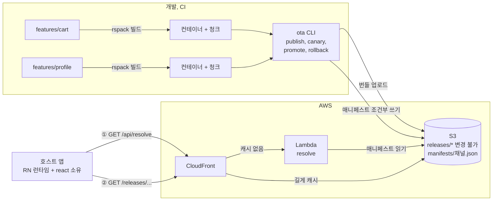
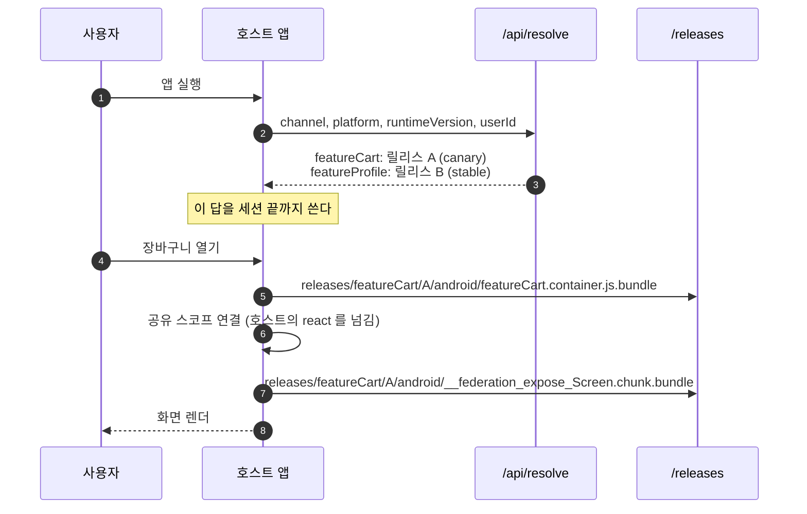
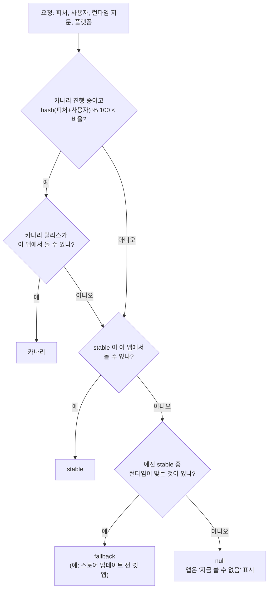
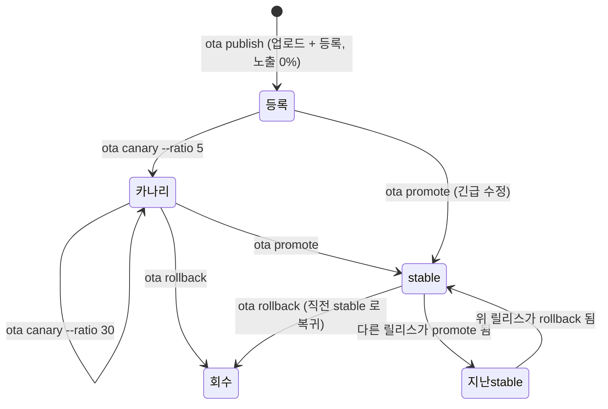
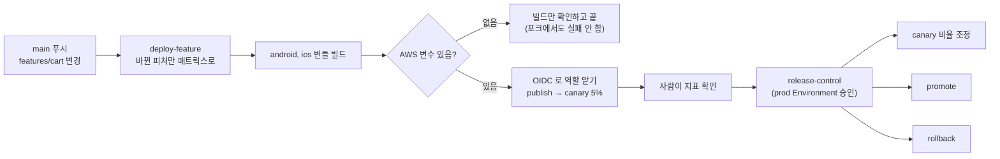

# rn-federated-ota

React Native 앱의 화면 일부를 **앱 스토어 심사 없이 따로 배포**하는 구조의 샘플입니다.
화면 단위 번들(Module Federation)을 S3와 CloudFront로 내려주고, 누구에게 어느 버전을 줄지(채널, 카나리, 롤백, 호환성)는 resolve API 한 곳에서 정합니다.

세 가지를 참고해 조합했습니다.

| 참고한 것 | 가져온 생각 | 이 저장소에서 |
|---|---|---|
| [Re.Pack](https://re-pack.dev) 의 Module Federation | 호스트가 react, react-native 를 들고 있고 화면 번들은 빌려 쓴다 | `apps/host`, `features/*` |
| Toss 의 [Granite](https://github.com/toss/granite) | 셸과 서비스 번들 사이의 버전 계약, 번들 배포 인프라를 프레임워크 일부로 본다 | 런타임 지문(`runtimeVersion`), `infra/` |
| [hot-updater](https://github.com/gronxb/hot-updater) | 자체 호스팅 OTA. 채널, 롤백, 앱과 호환되는 번들만 고르는 서버 측 판단 | `packages/ota-*` |

hot-updater 는 앱 번들 전체를 바꾸고, 이 저장소는 피처(화면) 번들 하나씩 따로 바꿉니다. 그래서 "어느 앱에 맞는 번들인가"를 앱 버전이 아니라 공유 의존성 지문으로 판단합니다. 아래 [설계 판단](#설계-판단)에 이유를 적었습니다.

## 구조



| 경로 | 무엇 | 캐시 |
|---|---|---|
| `GET /api/resolve` | 이 사용자, 이 앱에게 줄 피처별 릴리스 | 없음 (사용자마다 답이 다름) |
| `GET /releases/<피처>/<릴리스>/<플랫폼>/<파일>` | 번들 파일 | 1년, immutable (주소에 내용 해시) |
| 그 외 | 404 | |

매니페스트(`manifests/<채널>.json`)는 CDN 으로 공개하지 않습니다. 회수한 릴리스와 카나리 비율이 들어 있어서 밖에 보일 이유가 없습니다.

## 앱이 켜질 때



resolve 는 세션당 한 번입니다. 보는 도중에 배포가 바뀌어도 이번 세션은 처음 받은 릴리스를 씁니다. Module Federation 런타임은 한 번 로드한 컨테이너를 교체할 수 없고, 중간에 바꾸면 이미 연 화면과 새로 열 화면의 버전이 섞입니다. 새 배포는 다음 콜드 스타트에 반영됩니다.

앱 쪽에서 이 흐름을 쥐는 곳은 [`apps/host/src/ota/scriptManager.ts`](apps/host/src/ota/scriptManager.ts) 하나입니다. Re.Pack 이 "이 스크립트는 어디 있나"를 물으면 resolve 결과로 주소를 만들어 답합니다.

## 누구에게 어떤 번들을 주나

[`packages/ota-core/src/resolve.ts`](packages/ota-core/src/resolve.ts) 의 순서가 곧 정책입니다.



"이 앱에서 돌 수 있다"는 세 조건을 모두 만족한다는 뜻입니다. 회수(rollback)되지 않았고, 런타임 지문이 같고, 요청한 플랫폼 산출물이 있어야 합니다.

fallback 은 stable 을 이 앱에 줄 수 없을 때 모두 해당합니다. 가장 흔한 경우는 런타임이 다른 옛 앱이고, stable 에 요청한 플랫폼 산출물이 없거나 stable 을 전부 되돌려 비어 있을 때도 여기로 옵니다.

런타임 지문이 다른 번들은 어떤 경우에도 내려주지 않습니다. 피처 번들은 react, react-native 를 호스트에게서 빌려 쓰므로 버전이 어긋나면 화면이 깨지는 정도가 아니라 앱이 죽을 수 있습니다.

## 릴리스의 일생



번들 파일은 한 번 올리면 바뀌지 않습니다. CI 역할에는 덮어쓰는 업로드를 거부하는 IAM 조건(`s3:if-none-match`)을 걸어 약속이 아니라 권한으로 막았습니다. 배포, 카나리, 롤백은 전부 매니페스트의 포인터만 바꾸므로 다시 빌드하거나 다시 올릴 것이 없습니다. resolve Lambda 가 매니페스트를 인스턴스마다 5초까지 메모리에 들고 있어서, 바뀐 결정은 길어야 5초 뒤 다음 콜드 스타트부터 반영됩니다.

```bash
npm run ota -- publish featureCart --app features/cart --android features/cart/build/generated/android
npm run ota -- canary featureCart 20261122T031005-3f2a9c --ratio 10
npm run ota -- promote featureCart          # 진행 중인 카나리를 stable 로
npm run ota -- rollback featureCart         # 카나리 회수, 없으면 직전 stable 로 (대상 id 를 줄 수도 있음)
npm run ota -- status
```

CI 에서는 [`deploy-feature`](.github/workflows/deploy-feature.yml) 가 `features/` 변경을 감지해 빌드, 업로드, 카나리 5% 까지 하고, stable 승격과 롤백은 사람이 [`release-control`](.github/workflows/release-control.yml) 로 누릅니다.

## 자세한 로직

위 그림들을 코드 단위로 풀어 씁니다. 빌드에서 시작해 앱이 화면을 그리기까지 순서대로 따라갑니다.

### 1. 빌드: 호스트와 피처가 같은 계약을 갖게 하기

호스트와 피처의 `package.json` 에는 같은 목록이 있습니다.

```json
"ota": { "shared": ["react", "react-native"] }
```

이 목록 하나에서 세 가지가 나옵니다.

| 쓰는 곳 | 호스트 | 피처 |
|---|---|---|
| Module Federation `shared` (rspack 설정) | `eager: true`. 번들에 직접 넣고 공유 스코프에 올린다 | `eager: false`, `import: false`. 넣지 않고 호스트 것을 빌린다 |
| 런타임 지문 | 빌드 직전 `ota runtime-version` 이 `src/ota/runtimeVersion.generated.ts` 에 써서 번들에 박는다 | 배포할 때 CLI 가 계산해 매니페스트에 적는다 |
| 버전 요구 (`requiredVersion`) | `node_modules` 에 실제 설치된 버전 | 같음 |

런타임 지문은 목록의 패키지를 이름순으로 정렬해 `이름@설치버전` 을 줄바꿈으로 잇고 SHA-256 앞 12자리를 붙인 값입니다. 예: `rn0.76.9-8e48db7858da`. 호스트와 피처가 같은 설치 버전을 쓰면 같은 값이 나오고, 하나라도 다르면 달라집니다.

피처 빌드(`npm run bundle:android`)는 `build/generated/android/` 에 이런 파일을 만듭니다.

| 파일 | 크기(장바구니) | 역할 |
|---|---|---|
| `featureCart.container.js.bundle` | 약 150KB | 원격 컨테이너. 공유 스코프 협상과 노출 목록 |
| `__federation_expose_Screen.chunk.bundle` | 약 3KB | 화면 코드 자체 |
| `index.bundle` | 약 560KB | 빌드에 딸려 나오는 엔트리. react-native 사본이 들어 있어 올리지 않는다 |
| `*.map`, `mf-stats.json` | | 분석용. 올리지 않는다 |

### 2. 올리기: `ota publish`

[`publish.ts`](packages/ota-cli/src/publish.ts) 가 하는 일입니다.

1. `--app` 디렉터리로 런타임 지문을 계산합니다.
2. 산출물 디렉터리를 훑어 올릴 파일을 고르고(위 표에서 "올리지 않는다"는 제외), 파일마다 SHA-256 과 크기를 잽니다.
3. 릴리스 id 를 `시각(초 단위)-내용해시6자리` 로 만듭니다. 예: `20261122T031005-59bb86`.
4. 파일을 `releases/<피처>/<릴리스>/<플랫폼>/<파일>` 에 올립니다. `If-None-Match: *` 를 붙여 같은 키가 이미 있으면 실패하게 하고, `Cache-Control: max-age=31536000, immutable` 을 답니다.
5. 매니페스트에 릴리스를 **등록만** 합니다. `stable` 도 `canary` 도 건드리지 않으므로 이 시점에 받는 사용자는 0명입니다.

파일 업로드(4)가 매니페스트 등록(5)보다 먼저라서, 중간에 실패해도 매니페스트에는 흔적이 남지 않습니다.

### 3. 매니페스트: 채널당 JSON 하나

`manifests/prod.json` 의 모양입니다(파일 목록은 줄였습니다).

```json
{
  "schemaVersion": 1,
  "channel": "prod",
  "features": {
    "featureCart": {
      "releases": [
        {
          "id": "20261121T170201-59bb86",
          "runtimeVersion": "rn0.76.9-8e48db7858da",
          "platforms": { "android": [{ "path": "featureCart.container.js.bundle", "sha256": "3485...", "size": 152186 }] },
          "note": "cart v1",
          "promotedAt": "2026-11-21T17:02:10Z"
        },
        {
          "id": "20261121T170230-c3417b",
          "runtimeVersion": "rn0.76.9-8e48db7858da",
          "platforms": { "android": ["..."] },
          "note": "cart v2"
        }
      ],
      "stable": "20261121T170201-59bb86",
      "canary": { "releaseId": "20261121T170230-c3417b", "ratio": 30 }
    }
  }
}
```

`releases` 는 추가만 하고 지우지 않습니다. 한 번이라도 stable 이 된 릴리스에는 `promotedAt`, 되돌린 릴리스에는 `revokedAt` 이 붙습니다. 이 두 표시가 fallback 과 rollback 의 근거입니다.

매니페스트를 바꾸는 연산은 [`manifest.ts`](packages/ota-core/src/manifest.ts) 의 순수 함수들입니다.

| 연산 | 바뀌는 것 | 거부하는 경우 |
|---|---|---|
| `addRelease` | `releases` 에 추가 | 같은 id, 산출물 없음 |
| `startCanary(id, ratio)` | `canary = { id, ratio }` | 없는 릴리스, 회수됨, 이미 stable, 비율이 1~99 정수가 아님 |
| `promote(id)` | `stable = id`, `promotedAt` 기록, `canary = null` | 없는 릴리스, 회수됨. 이미 stable 이면 그대로 둠 |
| `rollback(id)` 카나리일 때 | 그 릴리스에 `revokedAt`, `canary = null` | 이미 회수됐으면 그대로 둠 |
| `rollback(id)` stable 일 때 | `revokedAt`, `stable` = 회수 안 된 직전 `promotedAt` 릴리스 | 카나리가 진행 중이면 카나리 먼저 |

### 4. 매니페스트 갱신: 읽고, 고치고, 조건부로 쓰기

[`updateManifest`](packages/ota-cli/src/manifestStore.ts) 의 루프입니다.

```
반복 (최대 5번):
  매니페스트와 etag 를 읽는다 (없으면 빈 매니페스트, etag 없음)
  next = 연산(매니페스트)
  저장한다. 조건: etag 가 그대로일 때만 (없었으면 "아직 없을 때만")
  성공하면 끝
  412/409 (누가 먼저 씀) 이면 처음부터 다시
```

다시 할 때 "계산된 결과"가 아니라 "연산"을 다시 적용하므로, 다른 배포가 그사이 추가한 피처나 릴리스가 지워지지 않습니다. `rollback`, `promote` 는 CLI 가 대상 id 를 먼저 정해 넘기므로 두 번 적용돼도 결과가 같습니다.

### 5. resolve API: 누구에게 무엇을

요청과 응답입니다.

```
GET /api/resolve?channel=prod&platform=android&runtimeVersion=rn0.76.9-8e48db7858da&userId=user-7

200 Cache-Control: private, no-store
{
  "channel": "prod",
  "runtimeVersion": "rn0.76.9-8e48db7858da",
  "features": {
    "featureCart":    { "releaseId": "20261121T170230-c3417b", "track": "canary", "basePath": "releases/featureCart/20261121T170230-c3417b/android/" },
    "featureProfile": { "releaseId": "20261121T170205-69712f", "track": "stable", "basePath": "releases/featureProfile/20261121T170205-69712f/android/" }
  }
}
```

[`handler.ts`](packages/ota-server/src/handler.ts) 의 처리 순서입니다.

1. 입력 검사. 채널 이름 형식, 플랫폼(`android`, `ios`), 런타임 지문과 userId 는 영문, 숫자, `._:-` 로 128자까지. 어기면 400.
2. 매니페스트를 읽습니다. 같은 Lambda 인스턴스 안에서는 5초 동안 메모리 캐시를 씁니다. 매니페스트가 없는 채널이면 `features: {}` 로 답합니다(앱은 원격 피처 없이 뜸).
3. 피처마다 [`resolveFeature`](packages/ota-core/src/resolve.ts) 를 부릅니다. 순서는 위 [누구에게 어떤 번들을 주나](#누구에게-어떤-번들을-주나) 그림과 같습니다.
   - 카나리 대상 판단: `FNV-1a 32bit("featureCart:user-7") % 100 < ratio`
   - "이 앱에서 돌 수 있다": 회수 안 됨, 런타임 지문 일치, 플랫폼 산출물 있음
4. 사용자마다 답이 달라서 `private, no-store` 로 공유 캐시를 막습니다. CloudFront 에서도 이 경로는 캐시 정책이 `CachingDisabled` 입니다.

### 6. 앱: 세션, 주소 결정, 로드

[`session.ts`](apps/host/src/ota/session.ts) 는 앱 프로세스마다 resolve 를 한 번만 부릅니다. 결과 약속(promise)을 들고 있다가 모든 요청에 같은 답을 주고, 실패하면 약속을 버려 재시도 버튼이 다시 요청하게 합니다. 타임아웃은 3초입니다.

[`scriptManager.ts`](apps/host/src/ota/scriptManager.ts) 는 Re.Pack 이 스크립트 주소를 물을 때 답합니다.

| Re.Pack 이 묻는 것 | 판단 | 만드는 주소 |
|---|---|---|
| `scriptId = featureCart` | 컨테이너 | `{기준주소}/{basePath}featureCart.container.js.bundle` |
| `scriptId = __federation_expose_Screen`, `caller = featureCart` | 그 피처의 청크 | `{기준주소}/{basePath}__federation_expose_Screen.chunk.bundle` |
| 해당 피처의 resolve 결과가 `null` | 이 앱에 맞는 릴리스 없음 | 주소 대신 오류를 던진다 |

빌드 설정의 `remotes` 에는 `ota://resolved-at-runtime/...` 라는 열 수 없는 주소를 적어 둡니다. 이 리졸버가 먼저(priority 100) 답하므로 실제로 쓰이지 않고, 혹시 리졸버를 거치지 않으면 엉뚱한 서버로 가는 대신 바로 실패합니다.

`import('featureCart/Screen')` 한 줄이 실제로 하는 일은 이렇습니다.

1. 리졸버가 준 주소로 컨테이너를 받아 실행합니다. 전역에 `featureCart` 가 생깁니다.
2. `container.init(공유스코프)` 로 호스트가 올려 둔 react, react-native 를 넘깁니다.
3. `container.get('./Screen')` 이 화면 청크를 요청하고, 리졸버가 같은 릴리스의 주소를 줍니다.
4. 모듈의 `default` 컴포넌트를 렌더합니다. 화면 안의 `useState` 가 동작하면 React 인스턴스가 하나라는 뜻입니다.

캐시를 켜 두지만(`cache: true`) 주소에 릴리스 id 가 들어 있어서, 새 배포는 새 주소이고 옛 캐시와 섞이지 않습니다.

### 7. 실패할 때

| 상황 | 앱의 동작 |
|---|---|
| 앱 시작 때 resolve 실패(서버 다운, 3초 초과, 5xx) | "resolve 실패" 와 재시도 버튼. 피처 버튼은 안 보임 |
| resolve 결과가 `null` (런타임이 맞는 릴리스 없음) | 그 피처만 "이 런타임에 맞는 릴리스 없음". 버튼 없음 |
| resolve 는 됐는데 번들 다운로드 실패 | 그 피처만 오류 문구와 재시도 버튼. 다른 피처는 정상 |
| 재시도 | 같은 세션의 같은 릴리스를 다시 받는다 |

번들 다운로드 실패는 그냥 두면 앱이 죽습니다. federation 런타임 안에서 던진 에러가 `import()` 의 reject 로 오지 않고 처리되지 않은 예외로 남기 때문입니다. [`mfFallbackPlugin.js`](apps/host/src/ota/mfFallbackPlugin.js) 가 `errorLoadRemote` 훅에서 이 에러를 가로채 `{ __otaLoadError }` 표식을 모듈 대신 돌려주고, 화면 쪽은 `default` 가 없으면 실패로 처리합니다.

재시도는 `import()` 를 다시 부르지 않습니다. 런타임이 첫 실패 때의 표식을 정상 모듈로 캐시해 두어서 네트워크를 타지 않기 때문입니다. 대신 [`loadFeature.ts`](apps/host/src/ota/loadFeature.ts) 가 위 1~3단계를 직접 합니다. 이때 호스트 공유 스코프가 없으면 빈 스코프로 진행하지 않고 멈춥니다. 빈 스코프로 시작하면 피처가 react-native 를 따로 찾으려 하기 때문입니다.

### 8. CI 흐름



배포 역할은 장기 키 없이 GitHub OIDC 로만 맡고, main 브랜치 실행과 이름을 정한 Environment(`prod`) 실행에만 열려 있습니다. 권한은 `releases/*` 업로드(덮어쓰기 금지 조건 포함)와 `manifests/*` 읽기, 쓰기뿐이고 삭제는 없습니다.

## 설계 판단

검토한 다른 방법과 고르지 않은 이유를 같이 적습니다.

**결정은 서버(resolve API)에서 한다.**
앱이 매니페스트를 직접 받아 스스로 고르는 방식(CodePush 계열)도 가능하고, 서버가 없어 더 단순합니다. 고르지 않은 이유는 두 가지입니다. 매니페스트 전체(회수한 릴리스, 다른 피처의 카나리 비율)가 모든 기기에 내려가고, 선택 규칙을 고칠 때마다 앱을 새로 내야 합니다. 서버에 두면 규칙 변경이 Lambda 배포로 끝납니다. 대가는 앱 시작마다 API 호출 한 번이고, 실패하면 원격 피처 없이 뜹니다.

**호환성 기준은 앱 버전이 아니라 런타임 지문이다.**
피처가 실제로 의존하는 것은 앱 버전이 아니라 호스트가 공유 스코프에 올린 react, react-native 의 설치 버전입니다. 앱 버전으로 판단하면 네이티브 변경 없는 앱 업데이트마다 피처를 다시 내야 하고, 반대로 앱 버전은 같은데 의존성만 바뀐 경우를 놓칩니다. 그래서 `package.json` 의 `ota.shared` 목록과 실제 설치 버전을 해시합니다([`runtime.ts`](packages/ota-core/src/runtime.ts)). 호스트는 빌드 때 이 값을 번들에 박고, 피처는 배포 때 매니페스트에 적습니다. Granite 가 셸과 서비스 번들 사이에 두는 버전 계약을 문자열 하나로 줄인 셈입니다.

**매니페스트 동시 수정은 S3 조건부 쓰기로 막는다.**
CI 에서 두 피처가 동시에 배포되면 둘 다 같은 매니페스트를 읽고 각자 고쳐 씁니다. 조건 없이 쓰면 늦게 쓴 쪽이 먼저 쓴 쪽의 변경을 지웁니다. DynamoDB 로 잠금을 따로 두는 방법도 있지만, 매니페스트가 채널당 파일 하나라 S3 의 `If-Match` 만으로 충분하고 관리할 리소스가 하나 줄어듭니다. 충돌하면 최신 매니페스트를 다시 읽고 같은 "의도"(예: 카나리 30% 시작)를 다시 적용합니다. 그래서 매니페스트 연산은 전부 순수 함수로 뒀습니다([`manifest.ts`](packages/ota-core/src/manifest.ts)).

다시 적용해도 안전하려면 연산이 멱등이어야 합니다. "지금 것을 되돌려라"는 두 번 적용되면 한 단계를 더 되돌립니다. 첫 쓰기가 사실 성공했는데 응답만 잃은 경우나, 두 사람이 동시에 누른 경우가 그렇습니다. 그래서 `rollback`, `promote` 는 CLI 가 먼저 대상 릴리스 id 를 정해 고정하고, 이미 되돌려진 릴리스에 다시 적용되면 아무것도 하지 않습니다.

같은 이유로 CI 워크플로에 concurrency 그룹을 두지 않았습니다. GitHub 은 그룹마다 대기 중인 실행을 하나만 남기고 나머지를 취소해서, 푸시가 몰리면 어떤 피처 배포가 조용히 빠집니다. 동시 실행은 조건부 쓰기가 막습니다.

**올리기와 내보내기를 나눈다.**
`publish` 는 업로드하고 등록만 합니다. 노출은 `canary`, `promote` 가 따로 합니다. 업로드가 중간에 실패해도 매니페스트에는 흔적이 없으니 반쯤 올라간 릴리스가 사용자에게 갈 일이 없고, 자동화(CI)와 판단(사람)의 경계가 명령 단위로 갈립니다.

**롤백은 포인터를 되돌리고 회수 표시를 남긴다.**
포인터만 되돌리면, 런타임이 안 맞는 옛 앱을 위한 fallback 경로가 문제의 릴리스를 다시 고를 수 있습니다. 회수(`revokedAt`)된 릴리스는 어떤 경로로도 다시 나가지 않습니다.

**피처는 공유 의존성의 폴백 사본을 갖지 않는다.**
Module Federation 기본값은 호스트 것을 못 찾을 때 쓸 react-native 사본을 피처 쪽에도 청크로 빌드합니다. 그 사본이 로드되면 런타임이 두 벌이 되어 앱이 죽습니다. 피처의 shared 설정을 `import: false` 로 두어 사본 자체를 만들지 않고, 호스트 것이 없으면 로드가 실패해 화면에 오류로 보이게 했습니다.

**카나리 버킷은 hash(피처 + 사용자) 다.**
`Math.random()` 이면 같은 사용자가 앱을 켤 때마다 버전이 바뀌고, 지표에서 두 집단이 섞입니다. 피처 이름을 섞는 이유는, 사용자 id 만 쓰면 버킷이 낮은 사용자가 모든 피처의 카나리를 한꺼번에 받아 문제가 났을 때 원인을 가르기 어렵기 때문입니다.

## 검증

| 무엇 | 어떻게 | 결과 |
|---|---|---|
| 매니페스트 연산(재시도 멱등 포함), resolve 정책, 버킷 분포, S3 조건부 쓰기 | `npm test` (node:test) | 39건 통과 |
| CDK 인프라 (공개 차단, 캐시 정책, IAM 최소 권한) | `npm test -w infra` | 7건 통과 |
| 배포 파이프라인 전체 | `npm run e2e` (실제 피처 빌드 → 로컬 서버 → 카나리 → 롤백) | 77건 통과 |
| 앱에서 실제로 받아 렌더 | Android 에뮬레이터(API 34) 릴리스 빌드 + 로컬 서버 | 4개 시나리오 확인 |


카나리 30% 상태에서 버킷이 86인 user-1 은 v1, 버킷이 28인 user-7 은 v2 를 받았습니다. `ota rollback` 한 줄 뒤 앱을 다시 켜자 user-7 도 v1 으로 돌아왔고, APK 는 다시 설치하지 않았습니다.

서버 로그로 확인한 다운로드는 피처당 두 건(컨테이너, 화면 청크)뿐이었고, react-native 는 다시 받지 않았습니다. 원격 화면 안의 `useState` 가 동작한다는 것이 호스트와 React 인스턴스를 공유한다는 증거입니다.

장애 시나리오는 두 가지를 봤습니다. 앱 시작 때 서버가 꺼져 있으면 resolve 실패 화면과 재시도 버튼이 뜹니다. resolve 뒤에 CDN 이 끊기면 그 피처만 오류가 나고 다른 피처는 정상이며, 서버가 돌아온 뒤 재시도하면 같은 릴리스를 받아 뜹니다. 어느 쪽도 앱이 죽지 않았습니다.

## 직접 돌려 보기

Node 22.18 이상이 필요합니다(TypeScript 를 빌드 없이 실행).

```bash
npm ci
(cd apps/host && npm ci) && (cd features/cart && npm ci) && (cd features/profile && npm ci)

npm test            # 단위 테스트
npm run e2e         # 로컬 end-to-end (기본 포트 4399, 쓰이는 중이면 PORT=다른번호 npm run e2e)
(cd apps/host && npm run typecheck)   # 호스트 타입 검사 (런타임 지문 파일 생성 포함)
```

Android 에뮬레이터에서 보려면:

```bash
# 1. 로컬 서버 (CloudFront + Lambda 역할)
npm run server

# 2. 피처 빌드, 배포
(cd features/cart && npm run bundle:android)
npm run ota -- publish featureCart --app features/cart --android features/cart/build/generated/android
npm run ota -- promote featureCart <위에서 나온 releaseId>

# 3. 호스트 앱 빌드, 설치, 사용자를 바꿔 가며 실행
(cd apps/host && npm run build:android)
adb install -r apps/host/android/app/build/outputs/apk/release/app-release.apk
adb shell am start -n com.otahost/.MainActivity --es userId user-7
```

AWS 에 올리려면:

```bash
cd infra && npx cdk deploy -c githubRepo=<owner>/<repo>
# 채널을 늘리면 -c githubEnvironments=prod,beta, Lambda 동시 실행을 묶으려면 -c reservedConcurrency=50
# 출력의 BaseUrl 을 OTA_BASE_URL 로 넣어 호스트를 빌드하고,
# BucketName, GithubDeployRoleArn 을 저장소 변수(OTA_BUCKET, AWS_ROLE_ARN, AWS_REGION)로 둔다.
```

GitHub 에서는 `prod` Environment 를 만들고 승인자와 배포 브랜치(main)를 지정해 두세요. 배포 역할은 main 브랜치 실행과, 이름을 정해 둔 Environment 실행만 맡을 수 있습니다.

## 디렉터리

```
apps/host/            호스트 앱 (RN 0.76, Re.Pack 5). 런타임과 공유 의존성 소유
  src/ota/            resolve 호출, 스크립트 주소 결정, 로드 실패 처리
features/cart/        원격 피처. react, react-native 는 빌려 씀
features/profile/     원격 피처 (다른 팀이 따로 배포한다고 가정)
packages/ota-core/    매니페스트 연산, resolve 정책, 버킷, 런타임 지문 (의존성 없음)
packages/ota-storage/ S3 와 로컬 디렉터리를 같은 인터페이스로 (읽기, 조건부 쓰기)
packages/ota-cli/     publish, canary, promote, rollback, status
packages/ota-server/  resolve 핸들러. Lambda 진입점과 로컬 서버가 같은 코드
infra/                S3, CloudFront, Lambda, GitHub OIDC 배포 역할 (AWS CDK)
scripts/e2e-local.sh  로컬 end-to-end 검증
```

## 하지 않은 것

- **실제 AWS 배포.** 인프라는 CDK 합성과 assertion 테스트, Lambda 번들 실행까지만 확인했습니다. CloudFront 의 실제 캐시 동작과 Lambda 콜드 스타트는 재지 않았습니다.
- **iOS 실행.** JS 쪽(resolve, 번들 주소)은 플랫폼을 가리지 않지만, 시뮬레이터에서 돌려 보지는 않았습니다. 저장소에 iOS 프로젝트도 넣지 않았습니다.
- **번들 서명.** 원격 번들은 앱 서명 바깥에서 오는 코드입니다. 지금은 HTTPS 와 내용 해시(매니페스트의 sha256)까지만 있고, 기기에서 서명을 검증하지 않습니다. 실서비스라면 Re.Pack 의 CodeSigningPlugin 으로 서명하고 ScriptManager 에서 검증해야 합니다.
- **지표 기반 자동 승격.** 카나리 비율을 올리거나 되돌리는 판단은 사람이 합니다. 크래시율을 보고 자동으로 rollback 하는 단계는 없습니다.
- **사용자 id 신뢰.** 카나리 버킷을 정하는 userId 는 앱이 보냅니다. 사용자가 값을 바꾸면 자기 버킷을 고를 수 있습니다. 실서비스라면 인증 토큰에서 꺼내야 합니다.
- **릴리스 서명 키.** 샘플의 Android 릴리스 빌드는 React Native 템플릿 기본값대로 공개된 디버그 키로 서명합니다.
- **오프라인 시작.** resolve 가 실패하면 원격 피처 없이 뜹니다. 마지막으로 받은 릴리스를 기기에 저장해 두고 쓰는 경로는 넣지 않았습니다.
